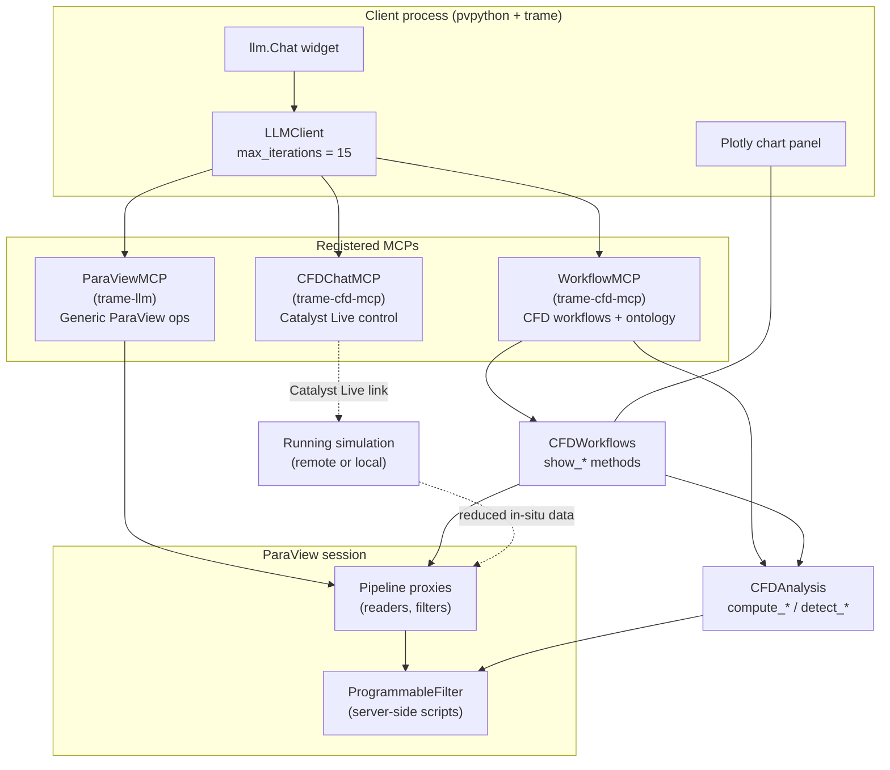

# Architecture

## TL;DR

trame-cfd-mcp exposes CFD visualization and analysis as a set of deterministic tools to an LLM. The LLM selects tools from natural-language queries and stitches results into explanations; it never writes ParaView code. All field-touching analysis runs server-side as `ProgrammableFilter` scripts; only scalar KPIs return to the client. A JSON ontology provides CFD domain knowledge for the LLM to reason with when explaining results, but never influences execution.

Four things make this work in practice:

1. **Deterministic workflows.** `show_vortices`, `show_slice`, and friends each do the full "pick a reader, compute derived fields, create filters, set up display, return provenance" sequence. The LLM picks one tool; it doesn't orchestrate six low-level calls.
2. **Server-side analysis.** Large simulation fields stay on the pvserver. The client only ever sees a small `vtkTable` of scalar KPIs — the precondition for the system to work against remote clusters and in-situ Catalyst data.
3. **Tool-argument normalization.** Each tool accepts semantic or sloppy arguments (`"velocity"`, `"opacity"`, `"line_width"`) and resolves them against the actual dataset or proxy. This is what makes open-weight models (qwen2.5-coder:32b) usable without frontier-model precision on tool-call arguments.
4. **Ontology for explanation, not execution.** The ontology is CFD domain knowledge the LLM uses to answer "what does this mean?" It is read via `get_ontology()` and is structurally incapable of affecting which workflow runs or how.

## Design evolution

Earlier approaches and why they were abandoned:

| Approach | Problem |
|----------|---------|
| LLM orchestrates dozens of fine-grained tools | Skips steps, wrong order, burns tokens |
| LLM with long instructions spelling out orchestration | Still unreliable; instruction drift at scale |
| Ontology-driven execution (RAG into workflow) | Retrieval non-deterministic; wrong workflow picked on ambiguous queries |
| Intent classification → hardcoded workflow | Works, but every new capability needs a new intent class |
| **Workflow tools + ontology for explanation (current)** | LLM does intent matching against tool descriptions; workflows execute deterministically; ontology is consulted only when explaining |

The current design treats tool descriptions as the intent surface. Adding a new workflow means adding a tool with a clear description — no separate intent classifier, no RAG index.

## Runtime structure

Three MCPs are registered with a single `LLMClient`. They share the same ParaView session.



The LLM talks to three MCPs but sees a single merged tool list. `WorkflowMCP` is the CFD-specific layer; `ParaViewMCP` provides generic ParaView escape hatches; `CFDChatMCP` is only present when Catalyst Live is enabled.

## Module inventory

Source is under `src/trame_cfd_mcp/`:

| File | Responsibility |
|---|---|
| `workflow_mcp.py` | `WorkflowMCP` class. Registers ~32 tools with the LLM: 8 CFD workflows, ontology access, refinement tools, general filter creation fallbacks, utilities. Builds the MCP declaration with LLM instructions. |
| `workflows.py` | `CFDWorkflows` class. Implements each `show_*` method: gets reader, calls `CFDAnalysis`, creates ParaView filters, renders chart if applicable, returns rich result with provenance. |
| `cfd_analysis.py` | `CFDAnalysis` class. Compute tools (`compute_vortex_field`, `compute_forces`, `compute_boundary_layer_profile`, …), detection tools (`detect_wake_region`, `detect_streamwise_direction`), analysis logging, filter-chain extraction. |
| `catalyst_live.py` | `CFDChatMCP` class. Catalyst Live connection management, monitor extraction, simulation control (pause/resume/step). Only registered when `--live` flag is used. |
| `cost_tracker.py` | `TrackedLLMClient` wrapper. Tracks tokens, tool calls, estimated cost per query. |
| `line_samplers.py` | Server-side sampling helpers used by boundary-layer and section probes. |
| `ontology.json` | CFD domain knowledge — flow features, causal relationships, analysis recommendations. |
| `server_scripts/*.py` | ParaView `ProgrammableFilter` scripts; one per compute operation. See table below. |

External dependencies relevant to the architecture:

- `trame-llm`: provides `LLMClient`, `ParaViewMCP`, and the `run_server_script` / `fetch_table` / `create_table_source` primitives that `CFDAnalysis` and `CFDWorkflows` build on.
- `ptc.apps.lite`: the trame app shell (`Lite`) used by the example CFD assistant.
- `trame-plotly`: chart rendering in the UI drawer.

## Tool surface

The LLM sees a flat list merged from all registered MCPs. Grouped by role:

**CFD workflows** (`CFDWorkflows`, via `WorkflowMCP`):
- `show_vortices` — Q-criterion, vorticity, or λ₂ isosurfaces
- `show_streamlines` — seeded from wake or from any existing proxy
- `show_slice` — wake, center, or spanwise with auto-detected axes
- `show_histogram` — field distribution, rendered as Plotly chart
- `show_forces` — force distribution along streamwise direction
- `show_boundary_layer` — single or multi-station BL profiles with δ, δ*, θ, H
- `show_boundary_layer_context` — companion debug view showing probe locations on the section
- `show_flow_topology` — vortex core lines via VTK `VortexCores`

**Discovery and inspection** (`WorkflowMCP` + `CFDWorkflows`):
- `list_data` — readers, filters, active source
- `get_fields` — point/cell fields with ranges and component counts
- `analyze_data` — dataset summary and workflow recommendations
- `get_filter_properties`, `list_properties` — inspect a proxy before modifying
- `proxy_info` — detailed proxy metadata

**Refinement** (mix of `WorkflowMCP` and `ParaViewMCP`):
- `update_representation`, `update_color`, `update_list_property`, `update_display_property`
- `set_filter_property` — set any property on any proxy
- `show_or_hide`, `focus_on`, `reset_camera`
- `delete_filter`, `clear_all_filters`, `hide_all_scalar_bars`

**General filter creation** (`ParaViewMCP`, fallback when a `show_*` tool fails or isn't a fit):
- `create`, `find_or_create` — construct any ParaView filter by name
- `list_compatible_filters` — filters applicable to a given source

**Knowledge and utilities**:
- `get_ontology` — returns the CFD ontology JSON
- `save_screenshot`, `save_all_charts`, `save_state`, `set_view`

**Catalyst Live** (`CFDChatMCP`, only with `--live`):
- `connect_live(host, port)`, `disconnect_live`
- `extract_live_data(name)`, `extract_monitors(channel)`
- `pause_simulation`, `resume_simulation`, `step_simulation`, `clear_breakpoint`
- `get_live_status`, `get_monitor_data`, `is_connection_alive`

The LLM is instructed to prefer `show_*` workflow tools first and fall back to general filter creation if a workflow fails. It is explicitly told not to present numbered option lists on failure — fallback tools first, ask only if truly stuck. This instruction lives in the MCP declaration's `instructions` field, not in a separate planner.

## Execution loop

The architectural pattern is **intent-match → deterministic execute → interpret**. The LLM decides only the first and last phases; execution is pure Python. Letting the LLM orchestrate every step was tried and rejected — it was non-deterministic, skipped steps, and burned tokens. The current design collapses the LLM's role to two narrow jobs it does well: mapping natural-language intent to the right tool, and explaining structured results.

Concretely, a single query goes through the standard tool-use loop: `LLMClient` (with `max_iteractions=15` per query) selects tools, executes them, feeds results back to the model. No separate planner class, no retrieval step, no intent classifier. The tool descriptions *are* the intent surface, and the workflow implementations enforce determinism.

What a typical query does:

1. **Intent match.** User sends a natural-language question. The LLM issues one or more tool calls based on tool descriptions and the MCP `instructions` string. For a compound question, multiple calls can come back in a single turn (e.g., `show_streamlines` + `show_slice` + `save_screenshot`).
2. **Execute.** Each workflow tool runs deterministically in Python: reads pipeline state, calls `CFDAnalysis` methods (which may execute `ProgrammableFilter` scripts on the pvserver), creates ParaView filters, builds and returns a rich result dict containing proxy names, computed values, and provenance. No LLM decisions during this phase.
3. **Interpret.** Results feed back to the LLM, which may issue follow-up tool calls (refinement, `get_ontology` for domain knowledge) or produce a text explanation combining the structured results with CFD knowledge from the ontology.
4. Loop exits when the LLM produces a final text response or hits the iteration limit.

Workflows return structured dicts rather than "ok" strings — thresholds, field ranges, proxy names, provenance chains, and usually a `tip` field with a concrete suggested next command. This gives the LLM material to reason with for follow-ups ("what threshold was used?", "show weaker structures too") without re-executing from scratch.

Example return from `show_vortices`:

```python
{
    "status": "created",
    "type": "vortex_isosurface",
    "method": "q_criterion",
    "proxy_name": "Vortices_q_criterion",
    "result": {
        "field": "Q",
        "threshold": 28.06,
        "field_range": [-23929, 75723]
    },
    "provenance": {
        "dataset": "test.vtm",
        "filter_chain": [...],    # auto-extracted from ParaView
        "analysis": [...],         # why threshold = 28.06
        "display": {"color_by": "Velocity", "representation": "Surface"}
    },
    "tip": "Threshold 28.06 is auto-computed. To show MORE structures: update_list_property('Isosurfaces', [14.03], 'Vortices_q_criterion')..."
}
```

## Server-side analysis

This is the core scalability mechanism. All analysis that touches field data runs on the pvserver as a `ProgrammableFilter`. The client receives a small `vtkTable` of scalar KPIs and nothing else. Without this, the system does not work against remote pvservers or multi-GB simulation data.

**Data flow:**

```
pvserver:   raw fields → ProgrammableFilter (numpy) → small vtkTable
client:     fetch_table() → Python dict of scalar KPIs
```

**Primitives in `trame_llm.paraview`:**

| Function | Purpose |
|---|---|
| `get_field_names(proxy)` | Field names and component counts via `GetDataInformation()`. Zero data movement. |
| `run_server_script(proxy, script_path, params)` | Embeds a `.py` script into a `ProgrammableFilter`; executes on pvserver. |
| `fetch_table(proxy)` | Fetches a small `vtkTable` result (KPIs only) to the client. |
| `fetch_data(proxy)` | **Restricted to Catalyst Live path and small geometry sections.** Never called on full field data. See "When `fetch_data` is legitimate" below. |
| `ensure_flat_input(proxy)` | Detects composite datasets via `GetDataInformation().GetDataSetTypeAsString()` (no data movement); returns `(flat_proxy, None, cleanup)`. |
| `create_table_source(columns, name)` | Constructs a pvserver-side `vtkTable` proxy from client-side data (used to build chart proxies). |

**Server scripts** in `src/trame_cfd_mcp/server_scripts/`. Each runs entirely on pvserver. Parameters are injected as Python assignments at the top of the script. Output is always a small `vtkTable`.

| Script | Inputs | Outputs |
|---|---|---|
| `field_statistics.py` | `FIELD_NAME`, `LOCATION` | min, max, mean, std |
| `field_histogram.py` | `FIELD_NAME`, `LOCATION`, `NUM_BINS` | bin_center[], count[] |
| `vortex_threshold.py` | `FIELD_NAME`, `METHOD`, `PERCENTILE` | threshold, field_min, field_max |
| `force_integration.py` | `PRESSURE_FIELD`, `STREAMWISE_IDX`, … | Fx, Fy, Fz, Cd, Cl |
| `force_distribution.py` | `PRESSURE_FIELD`, `FORCE_IDX`, `DIST_IDX`, `NUM_BINS` | station[], sectional_force[] |
| `detect_streamwise.py` | `VELOCITY_FIELD` | streamwise axis/direction, freestream velocity |
| `detect_wake.py` | `VELOCITY_FIELD`, `VELOCITY_DEFICIT`, … | wake centroid, bounds |
| `boundary_layer.py` | `VELOCITY_FIELD`, `SURFACE_POINT`, `SURFACE_NORMAL`, `PROBE_LENGTH` | y[], u[], δ, δ*, θ, H |
| `find_region.py` | `FIELD_NAME`, `MODE` (min/max) | location (x,y,z), value |
| `centroid.py` | — | centroid (x,y,z), bounds |

**When `fetch_data` is legitimate.** The rule is: full simulation field data stays on the server. Two specific cases are exceptions and they are documented:

- **Catalyst Live extracted data.** The simulation's in-situ pipeline already performs reduction (surface extraction, sampling, monitors) before any data reaches the pvserver-side proxy. Fetching from an `ExtractCatalystData` output does not move large fields.
- **Small 2D geometry sections.** `compute_boundary_layer_profile` fetches a plane cut of the body surface (a 2D airfoil cross-section) to determine surface point and normal for probe injection. This is small geometry, not a field.

**Data movement summary:**

| Path | Full field data | `fetch_data` allowed? | Analysis location |
|---|---|---|---|
| Remote pvserver | Stays on server | ❌ never | pvserver `ProgrammableFilter` |
| Catalyst Live extracted | Reduced in-situ | ✅ yes (small) | pvserver `ProgrammableFilter` |
| BL airfoil section | Small 2D geometry | ✅ yes (tiny) | Client (probe injection only) |

## Catalyst Live path

Catalyst Live is a separate data path from remote pvserver, with different fetch rules because data has already been reduced in-situ at the simulation before it reaches ParaView at all.

```
simulation (running) → Catalyst in-situ pipeline → ExtractCatalystData proxy (pvserver)
                                                          │
                                                          ▼
                                                  WorkflowMCP / CFDAnalysis
                                                  (same server-side analysis path)
```

`CFDChatMCP` owns the Live connection and exposes simulation control tools. `ExtractCatalystData` produces a small proxy on the pvserver side; once created, it behaves like any other pvserver proxy and all the normal `run_server_script` / `ProgrammableFilter` analysis applies.

**Live-specific tools** (only registered when `--live` is passed):

| Tool | Purpose |
|---|---|
| `connect_live(host, port)` | Open Catalyst Live connection, create `_live_link` |
| `disconnect_live()` | Close the connection |
| `extract_live_data(name)` | Call `ExtractCatalystData` → small proxy |
| `extract_monitors(channel)` | Extract residual/monitor data for convergence tracking |
| `pause_simulation()`, `resume_simulation()`, `step_simulation(n)` | Control simulation time stepping |
| `clear_breakpoint()` | Cancel a pending step or breakpoint |
| `get_live_status()`, `get_monitor_data()`, `is_connection_alive()` | Status introspection |

The example app (`examples/cfd_assistant/cfd_chat.py`) runs a lightweight asyncio loop that calls `nam.ProcessEvents(1)` at ~10 Hz to keep the Catalyst connection alive, and polls monitors at ~2 Hz to update the live residual chart in the UI drawer.

## Provenance tracking

Every workflow returns structured provenance. There are two sources and they are combined by the workflow:

**Filter chain — from ParaView.** `CFDAnalysis.extract_filter_chain(proxy)` walks `proxy.Input` recursively and records filter type, input/output names, and key parameters. This always reflects current state, so subsequent refinements are captured automatically on re-extract.

**Analysis log — from `CFDAnalysis`.** `_log_analysis(type, **details)` records the computational decisions ParaView doesn't know about: *why* threshold = 28.06 (50th percentile of positive Q), *where* the wake is (velocity deficit below 50% of freestream), *how* a streamline seed was placed (from wake centroid).

**Workflow pattern:**

```python
def show_vortices(self, ...):
    self._mcp.clear_analysis_log()            # fresh start per workflow

    vortex = self._mcp.compute_vortex_field(...)   # logs auto_threshold
    contour = simple.Contour(...)                  # ParaView records filter

    return {
        "provenance": {
            "filter_chain": self._mcp.extract_filter_chain(contour),
            "analysis":     self._mcp.get_analysis_log(),
        },
        ...
    }
```

Example combined provenance:

```json
{
  "filter_chain": [
    {"filter": "XMLMultiBlockDataReader", "output": "Reader1", "params": {"FileName": "test.vtm"}},
    {"filter": "MergeBlocks", "output": "MergeBlocks1", "input": "Reader1"},
    {"filter": "Gradient", "output": "Gradient1", "input": "MergeBlocks1",
     "params": {"ScalarArray": "Velocity", "ComputeQCriterion": 1}},
    {"filter": "Contour", "output": "Contour1", "input": "Gradient1",
     "params": {"ContourBy": "Q", "Isosurfaces": [28.06]}}
  ],
  "analysis": [
    {"type": "auto_threshold", "method": "percentile", "percentile": 50.0,
     "field_range": [-23929, 75723], "positive_count": 9257, "result": 28.06}
  ]
}
```

Provenance is registered in `CFDWorkflows._provenance_registry` keyed by proxy name, so downstream workflows that chain off a previous result can pick up the upstream reasoning.

## Tool-argument normalization

LLMs — especially open-weight models like qwen2.5-coder:32b — produce off-spec tool calls. They pass semantic field names instead of actual array names (`"velocity"` when the dataset calls it `U`), use snake_case where ParaView expects CamelCase (`"line_width"` vs `LineWidth`), pass separate velocity components when the vector was expected, or name properties approximately (`"pbr"` instead of `Interpolation="PBR"`).

trame-cfd-mcp handles this with **tool-local normalization**: each tool is responsible for accepting sloppy or semantic inputs and resolving them against the actual dataset or ParaView proxy. This is a structural pattern rather than a named middleware. The shared primitives are:

**Field-name resolution** (`CFDAnalysis`):

- `FIELD_TYPE_PATTERNS` — curated map from semantic names (`"velocity"`, `"pressure"`, `"density"`, `"temperature"`, `"mach"`, `"turbulent_kinetic_energy"`) to candidate real array names (`Velocity`, `U`, `u`, `vel`, `VELOCITY`, `flow_velocity`, …)
- `_resolve_field_type(field, proxy)` — two-pass matcher against the actual dataset's fields: exact case-insensitive match first, then substring match for patterns ≥ 3 chars. Pure metadata lookup — no data movement.
- `_get_available_fields(proxy)` — builds a full `semantic → actual` map for characterization and hint generation

Tools that accept a `field` argument call `_resolve_field_type` first. The LLM can pass `"velocity"`, `"Velocity"`, `"U"`, or the actual array name; they all resolve to whatever the dataset calls it.

**Vector-from-components synthesis** (`CFDAnalysis.ensure_velocity_vector`):

When the dataset has `u`, `v`, `w` as separate scalars and the LLM requests something that needs a velocity vector (streamlines, Q-criterion), `ensure_velocity_vector` detects this and synthesizes the 3-component vector via `Calculator`. Auto-detects component names using patterns (`u`/`U`/`Ux`/`VelocityX`/`velocity_x`/`ux`), accepts explicit overrides.

**Property-name aliasing** (`WorkflowMCP.update_display_property`):

A `property_map` dict accepts `"opacity"`, `"linewidth"`, `"line_width"`, `"point_size"`, `"pointsize"`, `"pbr"`, `"metallic"`, `"roughness"`, and maps them to ParaView's actual property names. The `"pbr"` shortcut is a special case — it sets `Interpolation = "PBR"` from a single-word hint.

**Analysis prerequisite validation** (`CFDAnalysis.validate_for_analysis`):

Before an expensive analysis runs, callers can validate whether the dataset has what's needed. Returns structured suggestions on failure:

```python
validate_for_analysis("streamlines")
# → {"valid": False, "missing_fields": ["velocity"],
#    "suggestions": ["Velocity components found: ['u', 'v', 'w']. Use ensure_velocity_vector() to combine them."]}
```

The LLM reads the suggestion and makes the corrective call on the next turn.

**Characterization for recommendation** (`CFDAnalysis.characterize_dataset`):

Runs the full semantic resolution across the dataset and returns inferred simulation type (`incompressible_turbulent`, `compressible_laminar_or_rans`, …) plus a list of `applicable_tools`. Gives the LLM a grounded starting point rather than requiring it to guess what tools exist for this particular dataset.

**Error returns as hints**:

Tools that can't succeed return dicts with `hint`, `available_fields`, `suggestions`, and `tip` fields rather than raw exception strings. Example from `ensure_velocity_vector`:

```python
{"error": "Cannot build velocity vector - missing: ['v component \"V\"']",
 "available_fields": ["u", "w", "p", "rho"],
 "hint": "Provide u_component, v_component, w_component explicitly"}
```

This closes the loop: normalization failures produce LLM-readable structured errors that let the model self-correct without human intervention.

**Tradeoffs.** This distributed approach keeps error messages domain-specific and lets each tool decide what "sloppy input" means in its context. The cost is that a new contributor can forget to route field arguments through `_resolve_field_type` and quietly break a tool for datasets with nonstandard naming. The shared primitives (`FIELD_TYPE_PATTERNS`, `_resolve_field_type`, `_get_available_fields`, the property map) are the convention — use them for every new tool that takes a field name or a property name.

## Ontology

`ontology.json` is a versioned, flat JSON file of curated CFD domain knowledge. Current version is `0.1`, domain `cfd_postprocessing` — the structure anticipates future ontologies for adjacent domains (in-situ, preprocessing, solver setup) without changing the consumer.

**Three top-level sections:**

`flow_features` — what each visualization method *means* and *how to interpret its numerical output*. Not just descriptions, but structured interpretation:

- For `vortex_isosurface` → three sub-methods (`q_criterion`, `vorticity`, `lambda2`) each with `definition`, `interpretation`, and `typical_use`, plus shared `threshold_guidance` ("higher threshold shows stronger/tighter vortex cores") and `coloring_guidance` ("color by velocity magnitude to see flow speed through vortex")
- For `boundary_layer` → a `metrics` dict that tells the LLM what δ, δ*, θ, H mean *numerically*: `"shape_factor": "H = δ*/θ, indicates flow state: H ≈ 2.6 (laminar), H ≈ 1.3-1.4 (turbulent), H > 3 suggests separation"`. This is what lets the LLM interpret a computed H = 1.4 as "turbulent boundary layer" without hallucinating.
- For `flow_topology` → a taxonomy of critical point types (source, sink, saddle) with interpretations that let the LLM read a structured topology result and explain what the critical points signify for design.

`causal_relationships` — physical cause-effect chains with evidence pointers:

```json
{"cause": "larger_wake", "effect": "lower_base_pressure", "evidence": ["wake_slice", "streamlines"]},
{"cause": "lower_base_pressure", "effect": "higher_pressure_drag", "evidence": ["force_distribution"]}
```

The `evidence` field names the workflow tools that produce the supporting visualization. This lets the LLM answer "why did drag increase?" by chaining through the relationships *and* knowing which tools to call next to confirm each link.

`analysis_recommendations` — for each analysis goal (vortex analysis, wake analysis, force analysis, boundary-layer analysis, separation analysis), lists `primary` tool, `supporting` tools, and `metrics` tools. Gives the LLM a principled starting point rather than requiring it to guess which tools combine well.

**How ontology combines with rich returns.** The ontology is useless on its own and so is the return dict. The LLM combines them:

| Question | Answered from |
|---|---|
| "What threshold was used?" | Workflow return (`result.threshold`) |
| "What does that threshold mean physically?" | Ontology (`flow_features.vortex_isosurface.methods.q_criterion.interpretation`) |
| "Is this H value indicating separation?" | Ontology (`flow_features.boundary_layer.metrics.shape_factor` regime guidance) + return (`shape_factor: 3.2`) |
| "Why would drag increase?" | Ontology (`causal_relationships.drag_increase`) — then propose tool calls to gather evidence |
| "What should I run next to analyze the wake?" | Ontology (`analysis_recommendations.wake_analysis`) |

This is the full pattern: **workflows produce structured facts, ontology provides structured meaning, the LLM combines them into explanations.** The LLM doesn't reason from its pretrained CFD knowledge alone; it reasons from pretrained knowledge *grounded by* the ontology and *anchored to* the specific facts in the returns.

**Why this matters architecturally.** Earlier designs tried to use the ontology for *execution* — RAG-retrieve the right workflow for a query, or retrieve sub-steps to orchestrate. Both failed: retrieval was non-deterministic, the wrong workflow got picked on ambiguous queries, and the workflow set didn't compose cleanly. Restricting the ontology to explanation is what makes execution reliable. The LLM's job at execution time is intent matching against tool descriptions (deterministic given the same model); the LLM's job at explanation time is synthesis over structured inputs (tolerant of model variation because the inputs are grounded).

**Evolution.** Adding a new flow-feature interpretation, a new causal relationship, or a new recommendation means editing `ontology.json`. No code change required. The `version` field is the hook for future schema changes — if the structure needs to evolve, code can branch on version.

## Chart rendering

Charts (histograms, boundary-layer profiles, force distributions, section debug views) flow through a pvserver-side `vtkTable` proxy rather than returning raw arrays to the LLM. The pattern:

1. Workflow computes chart data via `CFDAnalysis` (server-side where possible).
2. `_create_chart_table(chart_type, title, data)` builds a pvserver-side `vtkTable` proxy via `create_table_source` and records metadata (title, axis labels, chart type) in `_chart_metadata` keyed by proxy name.
3. Workflow returns `chart_proxy` name and scalar KPIs to the LLM — the raw arrays stay on the server.
4. The trame app's `render_chart_from_proxy(proxy_name)` fetches the table, reads metadata, and pushes a Plotly figure into the UI chart drawer.

The chart drawer shows up to 10 analysis charts plus a dedicated live-residual chart when Catalyst Live monitoring is active. The app (`examples/cfd_assistant/cfd_chat.py`) manages the widget slots and visibility state.

## Cost tracking

`TrackedLLMClient` wraps `trame-llm`'s `LLMClient` and records input tokens, output tokens, tool-call counts, and estimated cost per query. This is instrumentation, not control — nothing in the system gates on cost.

Concrete numbers depend heavily on the model and query; they change often enough that hardcoding them in this doc invites staleness. See `cost_tracker.py` and the example app's logs for current measurements. The architectural point is that rich structured returns and workflow-tool granularity keep per-query tool-call counts low (typically single digits) compared to a design where the LLM orchestrates fine-grained primitives.

## Adding a new workflow

1. Add a method to `CFDWorkflows` in `workflows.py`. The method should: get the data reader explicitly (do not rely on active source); call `CFDAnalysis` compute/detect methods for any field-touching work (which routes through `ProgrammableFilter`); create ParaView filters; build and return a rich result dict with `proxy_name`, `result`, `provenance`, and `tip`.
2. Add the method to the `tools` list in `WorkflowMCP.get_mcp()`.
3. If the workflow introduces a new flow feature concept, add it to `ontology.json` under `flow_features`.
4. Add a test to `tests/` (or the example assistant's `test_workflows*.py`).

Minimal skeleton:

```python
# In workflows.py
def show_pressure_contours(self, num_contours: int = 10) -> dict:
    """Show pressure contours on body surface."""
    view = simple.GetActiveView()
    proxy = self._get_data_reader()
    self._mcp.clear_analysis_log()

    # ... compute thresholds via self._mcp, create filters, show ...

    provenance = {
        "dataset": self._get_dataset_filename(proxy),
        "filter_chain": self._mcp.extract_filter_chain(contour),
        "analysis":     self._mcp.get_analysis_log(),
        "display":      {...},
    }
    self._register_provenance(name, provenance)
    self._notify_pipeline_changed()
    return {
        "status": "created",
        "type": "pressure_contours",
        "proxy_name": name,
        "provenance": provenance,
        "tip": "...",
    }

# In workflow_mcp.py get_mcp()
"tools": [
    # ... existing tools ...
    self._workflows.show_pressure_contours,
]
```

## Planned extensions

### `case_preflight` and CFD failure taxonomy

A pre-execution check tool plus a curated failure taxonomy. Same architectural principle as the existing separation of execution from explanation: replace open-ended LLM reasoning with closed-ended classification against a curated structure.

Preflight checks (mesh quality, y+/turbulence-model compatibility, Re regime, BC well-posedness, unit consistency, Conduit schema compatibility for Catalyst cases) run server-side against the loaded pipeline and return a structured JSON report with severity levels. The LLM reads the report before any run/solve workflow fires. The failure taxonomy is a flat YAML file of ~20–30 human-curated entries matched via BM25 retrieval, used for post-hoc classification when a workflow fails or returns a non-physical result.

Fits the current architecture as additive tools — no changes to existing workflows. See `docs/design/case_preflight.md` for the full design.

### Eval harness

A small fixed prompt set plus runner that scores LLM-driven CFD workflows on tool-selection correctness, argument validity, and explanation groundedness. Purpose: settle design questions (ontology hints on/off, which models are usable, whether instruction changes regress behavior) by measurement rather than by vibes. ~25 prompts covering single-tool, multi-tool, causal, expert-threshold, and normalization categories; configurable to swap models and toggle hint behavior; produces a markdown report per run.

See `docs/design/eval_harness.md` for the full design.

## What this architecture doesn't do

- **Novel tool combinations.** The system composes workflows the LLM selects, not workflows it invents. A question that requires a tool that doesn't exist yet gets an approximate answer at best.
- **Adaptive debugging.** When a workflow fails or produces garbage, the LLM has to reason from error messages rather than from a structured failure model. `case_preflight` + taxonomy (see Planned Extensions) addresses the common cases but doesn't generalize to unseen failure modes.
- **Multi-case comparison at scale.** Works for 2–3 cases via repeated queries; a dedicated comparison workflow would be needed for ensembles or parameter sweeps.
- **Model-agnostic reliability.** Tool-use behavior varies across LLMs. Frontier models (GPT-4o, Claude Sonnet 4+) follow the workflow pattern reliably; open-weight models like qwen2.5-coder:32b produce more off-spec tool calls — wrong argument types, hallucinated tool names, slightly wrong enum values. The tool-argument normalization layer (see above) absorbs the common cases; what it doesn't catch is fully fabricated tool names or structurally broken tool-call JSON. Those still require either a stronger model or additional handling at the `LLMClient` dispatch level.

These are intentional limitations. The design target is reliable execution and grounded explanation, not unbounded exploration.
