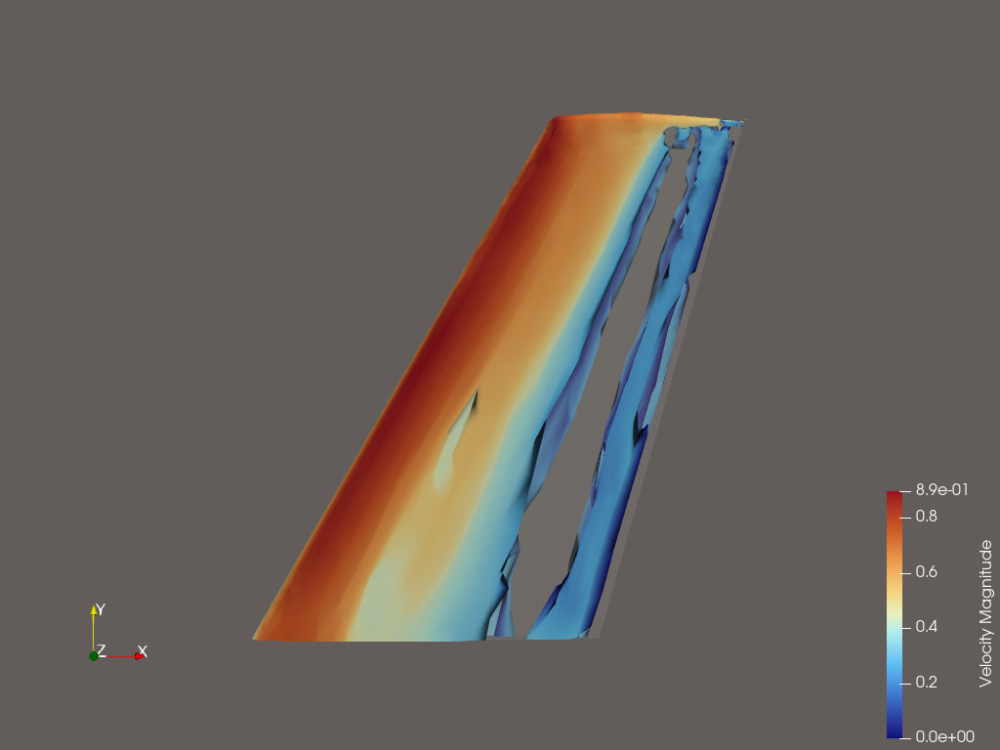
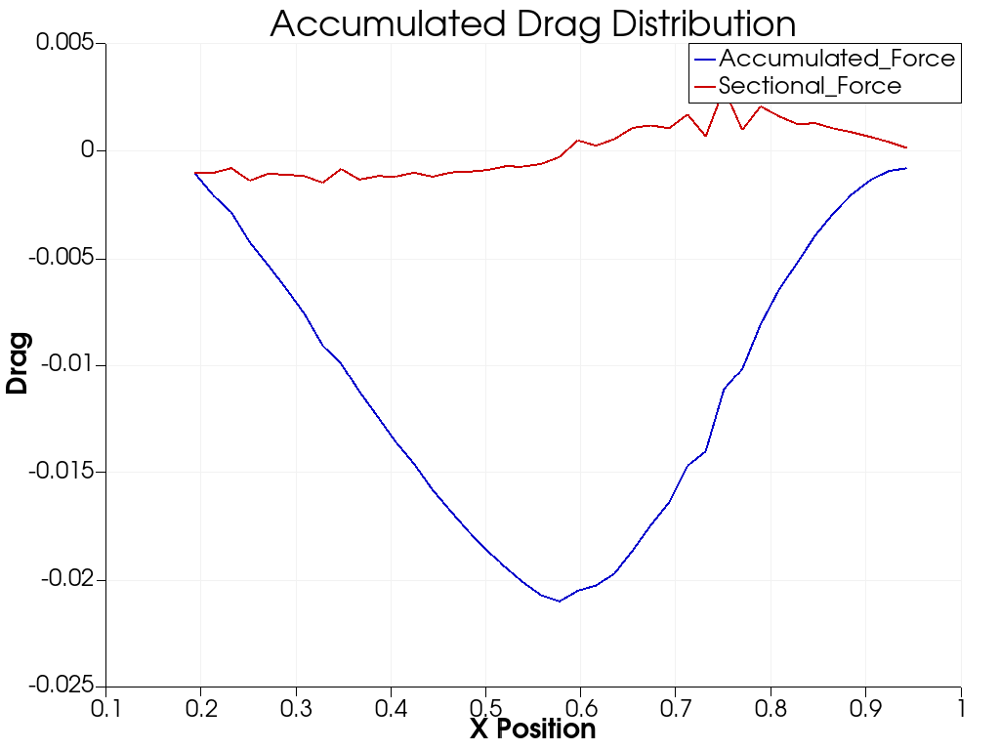
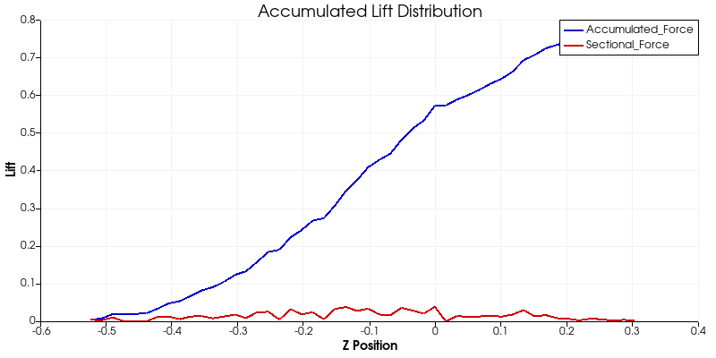
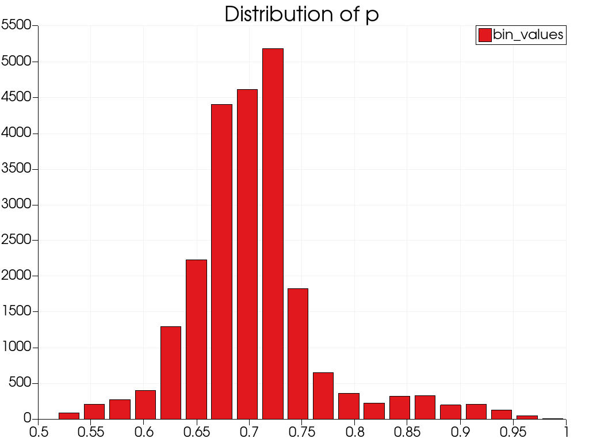

# ParaView LLM

Natural language interface for CFD post-processing with ParaView.

## Overview

ParaView LLM enables natural language queries for CFD visualization:

```
"show me the vortices"  →  Q-criterion isosurface with optimal threshold
"where is the stagnation point"  →  Find minimum velocity location
"calculate drag and lift"  →  Integrated pressure forces with Cd/Cl
"what have we done?"  →  Summary of session history
```

## Key Features

- **Safe Tiered Architecture**: LLM classifies intent → deterministic workflows execute
- **13 CFD Workflows**: Vortex detection, forces, wake analysis, flow features
- **Session Tracking**: Ask "what have we done?" to see analysis history
- **View-Independent Queries**: QuerySelect works without active view
- **Auto-Detection**: Streamwise direction, field types, optimal thresholds

## Installation

```bash
pip install paraview-llm

# With OpenAI support
pip install paraview-llm[openai]
```

## Quick Start

```python
from paraview import simple
from trame_llm.paraview import ParaViewMCP
from paraview_llm import ExtendedParaViewMCP, CFDAssistant

# Load data
reader = simple.OpenDataFile("simulation.vtm")
simple.UpdatePipeline()

# Get reader name
reader_name = None
for name, proxy in simple.GetSources().items():
    if proxy == reader:
        reader_name = name[0]
        break

# Setup MCP stack
base_mcp = ParaViewMCP(app)
extended_mcp = ExtendedParaViewMCP(base_mcp)

# Create assistant
assistant = CFDAssistant(extended_mcp, base_mcp, reader_name)

# Natural language query
result = assistant.query("show me the vortices")
print(f"Intent: {result['intent'].type.value}")
print(f"Success: {result['success']}")
```

## Architecture

```
┌─────────────────────────────────────────────────────────────────────────────┐
│                   SAFE TIERED ARCHITECTURE                                  │
│                                                                             │
│  PRINCIPLE: LLM never makes execution decisions                             │
├─────────────────────────────────────────────────────────────────────────────┤
│                                                                             │
│  User: "show me the vortices"                                               │
│                       │                                                     │
│                       ▼                                                     │
│  ┌─────────────────────────────────────────┐                                │
│  │  Tier 1: Intent Classification (LLM)    │  ~150 tokens                   │
│  │  Single call to classify user query     │                                │
│  │  → IntentType.VISUALIZE_VORTICES        │                                │
│  └─────────────────────────────────────────┘                                │
│                       │                                                     │
│                       ▼                                                     │
│  ┌─────────────────────────────────────────┐                                │
│  │  Tier 2: Workflow Selection             │  No LLM                        │
│  │  WORKFLOWS[intent] → predefined steps   │                                │
│  └─────────────────────────────────────────┘                                │
│                       │                                                     │
│                       ▼                                                     │
│  ┌─────────────────────────────────────────┐                                │
│  │  Tier 3: Execution                      │  No LLM                        │
│  │  Run steps deterministically            │                                │
│  └─────────────────────────────────────────┘                                │
│                       │                                                     │
│                       ▼                                                     │
│  ┌─────────────────────────────────────────┐                                │
│  │  Tier 4: Result Summary (LLM, optional) │  ~250 tokens                   │
│  │  Explain what was done                  │                                │
│  └─────────────────────────────────────────┘                                │
│                                                                             │
│  Total: ~1,200 tokens per query (vs 250K+ tokens with tool-loop approach)   │
│                                                                             │
└─────────────────────────────────────────────────────────────────────────────┘
```

### Why This Architecture?

| Old Tool-Loop | Safe Tiered |
|---------------|-------------|
| LLM in execution loop | LLM only classifies |
| 250K+ tokens / query | ~1,200 tokens / query |
| Endless retries | Deterministic |
| State confusion | Clean state tracking |
| $0.04 per query | ~$0.0002 per query |

## Available Workflows (13 tested)

| Category | Workflow | Description |
|----------|----------|-------------|
| **Vortex** | visualize_vortices | Q-criterion vortex visualization |
| | visualize_vortices_lambda2 | Lambda2 vortex cores |
| | visualize_vortices_helicity | Helical structures |
| **Flow** | visualize_wake | Wake region with streamlines |
| | visualize_streamlines | Flow streamlines |
| **Forces** | compute_forces | Compute drag/lift |
| | analyze_drag | Drag distribution chart |
| | analyze_lift | Lift distribution chart |
| **Analysis** | field_statistics | Min/max/mean of field |
| | field_histogram | Histogram chart |
| **Location** | find_stagnation | Find stagnation point |
| | find_maximum | Find field maximum |
| | find_by_query | Query-based search |
| **Session** | describe_session | What have we done? |

## Components

```
paraview_llm/
├── cfd_assistant.py     # Safe tiered architecture
├── extended_mcp.py      # CFD analysis tools (30+ tools)
├── mock_llm.py          # Deterministic test sequences
├── ontology_triples.py  # CFD domain knowledge
└── ontology_planning.py # Semantic planning (research)
```

### Extended MCP Tools

CFD-specific tools built on trame-llm's ParaViewMCP:

| Category | Tools |
|----------|-------|
| **Analysis** | `find_minimum`, `find_maximum`, `find_by_query`, `query_select`, `field_statistics` |
| **Forces** | `compute_forces`, `create_force_distribution_chart` |
| **Vortex** | `create_vortex_isosurface` (Q, λ2, swirl, vorticity, helicity) |
| **Wake** | `detect_wake_region`, `find_by_threshold` |
| **Charts** | `create_histogram_chart`, `field_histogram` |
| **Visualization** | `create_streamlines`, `create_vortex_isosurface` |
| **Utility** | `detect_streamwise_direction`, `hide_all`, `show_data_context`, `focus_on` |

## Testing

```bash
cd examples/cfd_assistant

# Run all workflow tests (requires OPENAI_API_KEY)
pvpython -u --venv .venv test_all_workflows.py
# → 13/13 tests passing

# Headless testing
pvpython --venv .venv headless.py --mock  # Mock mode (no API)
pvpython --venv .venv headless.py         # Real LLM mode
```

## Example Outputs

### Vortex Visualization (Q-criterion)


### Accumulated Drag Distribution


### Spanwise Lift Distribution


### Pressure Histogram


## Environment Variables

```bash
export OPENAI_API_KEY="sk-..."       # Required for real LLM mode
```

## License

Apache 2.0
